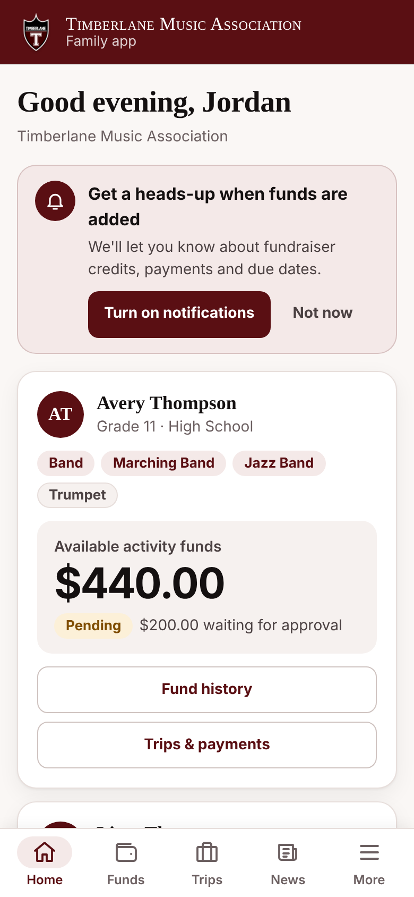
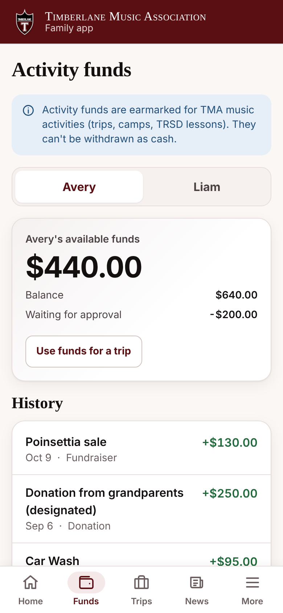
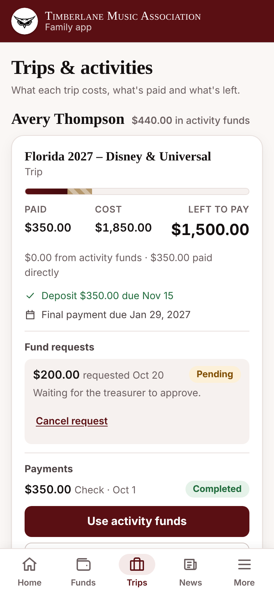
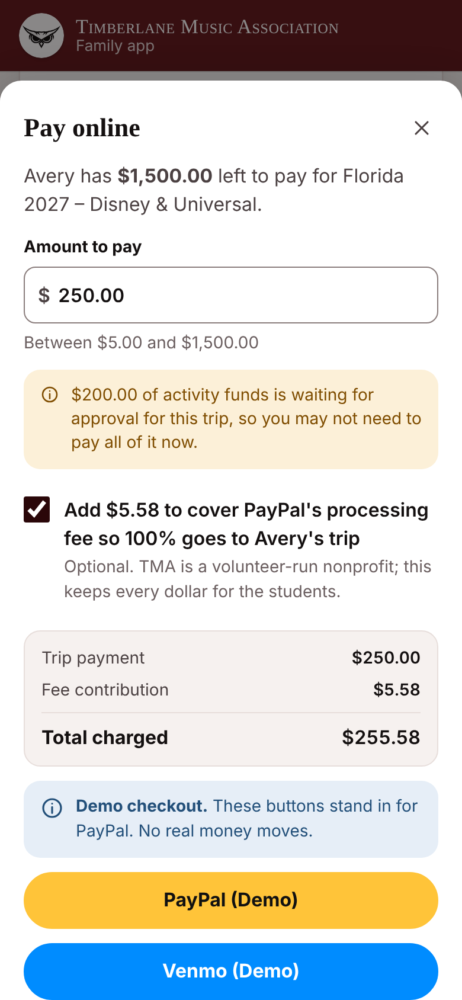
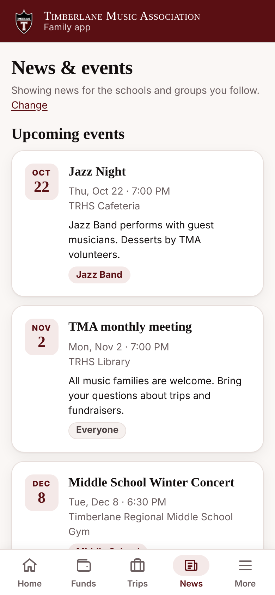
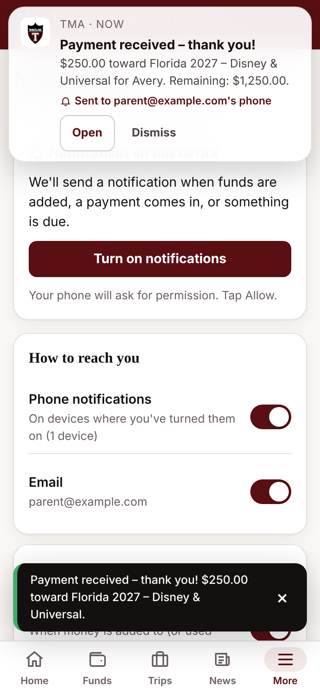
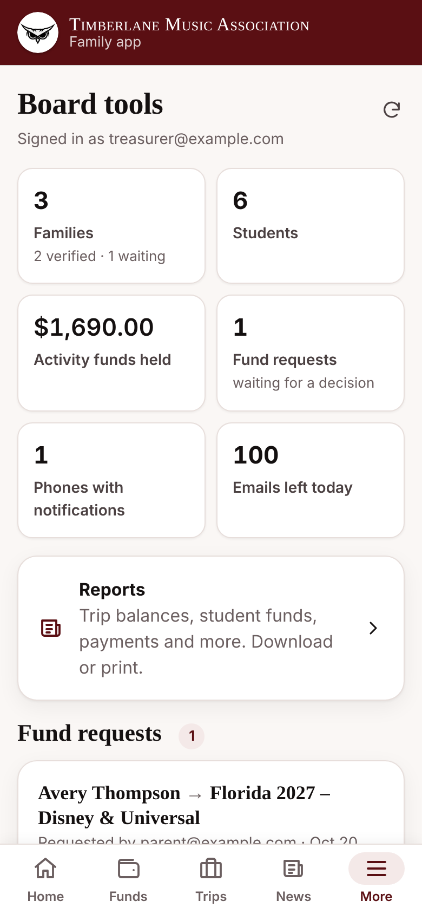
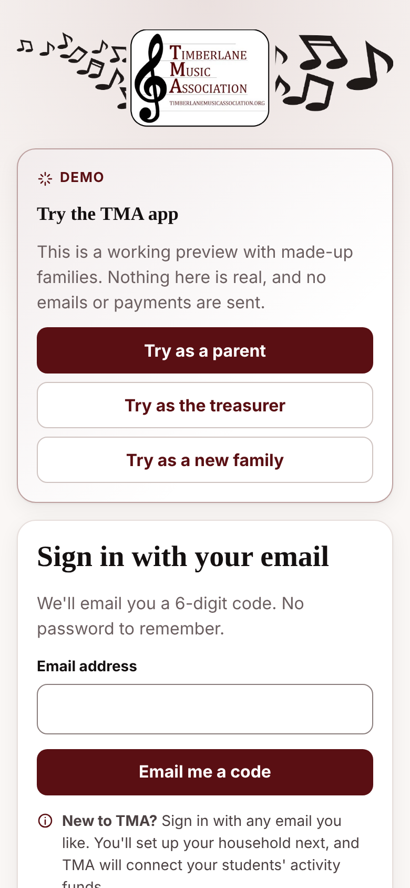
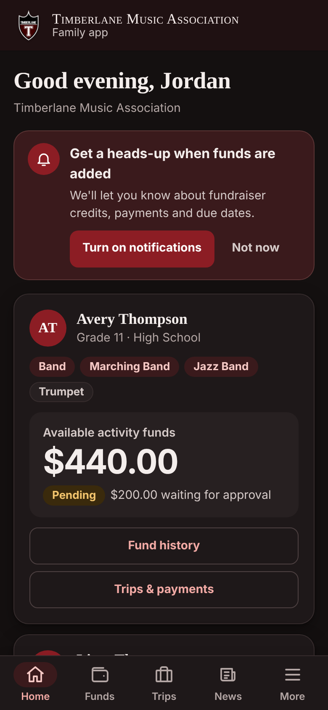

# TMA Family App


A free phone app for the families of the
[Timberlane Music Association](https://sites.google.com/view/timberlanemusicassociation/home) (TMA),
the volunteer-run 501(c)(3) booster club for the music programs at Timberlane Regional Middle and
High Schools in Plaistow, NH.

It is a **Progressive Web App (PWA)**: families open a link, tap **Add to Home Screen**, and it
works like an app on iPhone and Android. Nobody has to download anything from an app store. The
treasurer keeps working in **the same Google Sheet** as today. The app reads that sheet, keeps
balances straight and notifies families when something changes.

## What it does

**For families**

* See each student's **activity-fund balance** (money earned through fundraisers and earmarked for
  music activities) and the full history of credits and uses.
* See each **trip or activity**: what it costs, what's been paid, what's left and when it's due.
* **Use activity funds for a trip**: the parent asks in the app and the treasurer approves.
* **Pay the rest online** with PayPal, Venmo, or a debit/credit card (through PayPal), or see how to
  pay by check.
* **Choose what to hear about**: High School, Middle School or Elementary; Band, Marching Band, Jazz
  Band, Orchestra, Chorus or Guitar; and topics (fund changes, payments, reminders, news).
* Get **push notifications** on their phone, for example *"$50.00 was added to Avery's TMA activity
  funds."* Email is also available, and text messages if TMA turns them on.
* **Sign up themselves**. The school can't share family emails, so parents register their own
  household (parent name, email, optional cell, and each student's name, grade, school and groups).
  The treasurer verifies the household before any money information is shown.
* Sign in with a **one-time code sent by email**. There are no passwords to remember.

**For the treasurer and board**

* Keep using **one Google Sheet**: record fundraiser credits, checks and trip enrollments as you do
  now. See [docs/SHEET.md](docs/SHEET.md).
* **Approve fund requests** and **verify new households** in the app (*More → Board tools*) or
  in the sheet.
* **Send announcements** to everyone or only to some schools and groups, by push, email or text.
* Automatic **payment-due reminders** and **"concert tomorrow"** reminders.

## Try the demo

The demo runs entirely in your browser with made-up families. No emails, payments or real
notifications are sent, and nothing leaves your computer.

**Online, nothing to install:** add `?demo` to the app's address, for example
**https://coledtouch.github.io/TMA/?demo**. This works even after the site is connected to TMA's
real spreadsheet: that browser shows the demo, with a strip at the top saying so, until you tap
**Exit demo**. The demo's sign-ins and data are kept apart from the real app's. The real app's
sign-in screen also has a *See a demo with sample data* link. Until the site is connected (see
[Hosting](docs/SETUP.md#7-host-the-app-on-github-pages)), the whole site is the demo.

**On your own computer** you need [Node.js](https://nodejs.org/) 20 or newer:

```bash
npm install
npm run dev
```

Open the address it prints (usually http://localhost:5173/). With no backend address configured,
the app starts in **demo mode**. Either way, the demo works like this:

* **Try as a parent** signs in as `parent@example.com` (Jordan Thompson, with students Avery and Liam).
* **Try as the treasurer** signs in as `treasurer@example.com`, who sees *More → Board tools* with a
  fund request and a new household waiting for review.
* **Try as a new family**, or type **any other email**, to walk through sign-up.
* There is no real email in the demo: the sign-in code is shown on screen and filled in for you.
* **Demo controls** (under **More**): pretend to be the treasurer and post a fundraiser credit for a
  student, then watch the notification arrive. Turn on notifications first (*More → Notifications →
  Turn on notifications*) to see a real phone/desktop notification. The card also lists everything
  the demo "sent" and has a **Reset demo data** button.

Demo data is saved in your browser, so you can come back to it later.

## Screenshots

| Home | Activity funds | Trips |
| --- | --- | --- |
|  |  |  |

| Pay online | News & events | Notifications |
| --- | --- | --- |
|  |  |  |

| Board tools | Sign in | Dark theme |
| --- | --- | --- |
|  |  |  |

The screenshots are taken from the demo at iPhone 13 size by `npm run screenshots`.

## What it costs

Everything runs on free services (TMA's own Google account, GitHub Pages and Cloudflare Workers)
except one choice: sending the app's email from **noreply@mytma.org**, which needs Cloudflare's
Workers Paid plan ($5 a month). Without it, the app emails from TMA's Gmail for free.

| Piece | Cost | Notes |
| --- | --- | --- |
| Google Sheet and Apps Script (the app's server) | **$0** | |
| Email from noreply@mytma.org (Cloudflare Email Sending, through the push Worker) | **$5 a month** | Cloudflare's Workers Paid plan: 3,000 emails a month included (sign-in codes, notifications, announcements), then $0.35 per 1,000. Replies go to `SUPPORT_EMAIL`. See [docs/SETUP.md](docs/SETUP.md#email-from-noreplymytmaorg). |
| Email from TMA's Gmail instead (Settings `EMAIL_VIA` = `gmail`), and the automatic fallback | **$0** | A free Gmail account can email about 100 recipients a day, including sign-in codes. Free [Google Workspace for Nonprofits](https://www.google.com/nonprofits/) raises that to about 1,500. |
| Push notifications (TMA's push Worker on Cloudflare) | **$0** | Works on Cloudflare's free Workers plan (100,000 requests a day; one request carries up to 5 notifications), and costs nothing extra on Workers Paid. No charge per message. |
| Hosting the app (GitHub Pages) | **$0** | Free for public repositories. |
| Using activity funds for a trip | **$0** | An internal ledger entry. No payment processor is involved. |
| Checks and cash | **$0** | |
| Online payments (PayPal, Venmo, cards) | **Per payment** | 1.99% + $0.49 at PayPal's Confirmed Charity rate (3.49% + $0.49 standard). Families can choose to cover the fee so TMA receives the full amount. See [docs/PAYMENTS.md](docs/PAYMENTS.md). |
| Text messages (Twilio) | **Optional** | Off by default. About 1¢ per text plus a small monthly phone-number fee. |

## How it works

```
 Parents' phones (the app)          TMA's Google account (free)
┌────────────────────────┐  HTTPS  ┌─────────────────────────────────────┐
│ React PWA              │ ──────▶ │ Apps Script web app                 │
│ service worker         │         │  reads/writes ▶ TMA's Google Sheet  │
│ (push + offline)       │         │  every 15 min sync, Gmail fallback  │
└──────────▲─────────────┘         └──────┬───────────────┬──────────────┘
           │ push                         │               │
   phone's push service ◀── push Worker ◀─┘          PayPal REST
   families' inboxes ◀───── (Cloudflare: push,
                            email as noreply@mytma.org)
```

The app talks to a script inside TMA's Google account, which reads and writes the treasurer's
Google Sheet. Phone notifications go through a tiny **push Worker** on Cloudflare's free plan
([workers/push](workers/push/README.md)). It only encrypts each notification and hands it to Apple,
Google, Mozilla or Microsoft for delivery. It stores no family information: the phones' notification
addresses stay in TMA's sheet. The same Worker sends the app's emails as **noreply@mytma.org**
(Cloudflare Email Sending), with replies going to TMA's `SUPPORT_EMAIL`. If it can't send one, the
script sends that email with Gmail instead, so sign-in codes always arrive.

The full design, including every API action, notification message and scheduled job, is in
[docs/ARCHITECTURE.md](docs/ARCHITECTURE.md).

## Documentation

| Document | For | What's in it |
| --- | --- | --- |
| [docs/SETUP.md](docs/SETUP.md) | Whoever sets it up | Step-by-step production setup (about an hour, all free), updating, troubleshooting. |
| [docs/SHEET.md](docs/SHEET.md) | Treasurer | Every tab and column, the daily workflow, importing the existing spreadsheet, all settings. |
| [docs/PAYMENTS.md](docs/PAYMENTS.md) | Board | Can card payments be fee-free? Fees compared, how the app gets TMA to $0 net cost, IRS caution. |
| [docs/BOARD-FAQ.md](docs/BOARD-FAQ.md) | Board | Privacy, security, liability, costs, and what happens if the volunteer developer leaves. |
| [docs/ARCHITECTURE.md](docs/ARCHITECTURE.md) | Developers | Behavior spec and contracts. |
| [apps-script/README.md](apps-script/README.md) | Whoever sets it up | The two files that go into Apps Script. |
| [workers/push/README.md](workers/push/README.md) | Developers | The push Worker on Cloudflare: its API (push and email), deployment, plan limits and key rotation. |

## Privacy in short

* **Collected:** parent names, emails, an optional cell number, and each student's first and last
  name, grade, school, groups and (optionally) instrument. Plus each family's notification choices.
* **Not collected:** home addresses, birthdates, Social Security numbers, card or bank numbers,
  student emails or phone numbers, or any school records.
* **Where it lives:** in TMA's own Google Sheet, in TMA's Google account. There is no separate
  database. The push Worker on Cloudflare keeps no family information. Card payments are handled
  entirely by PayPal, so TMA never sees card numbers.
* **Who sees what:** a parent sees only their own household. Balances and trips appear only after
  the treasurer verifies the household. Board members listed in the sheet's Settings tab see what
  they need to approve requests and sign-ups.

More detail: [docs/BOARD-FAQ.md](docs/BOARD-FAQ.md).

## For developers

| Command | What it does |
| --- | --- |
| `npm run dev` | Start the app locally (demo mode unless `VITE_API_URL` is set in `.env.local`; see `.env.example`). |
| `npm test` | Unit and integration tests (Vitest), including the demo walkthrough and, once `npm run build:gas` has run, checks of `apps-script/Code.js` itself; then the Cloudflare Workers' tests (`workers/push`, `workers/app`). |
| `npm run typecheck` | TypeScript checks for the web app, service worker, Apps Script code, configs and both Cloudflare Workers. |
| `npm run build` | Typecheck, then build the web app into `dist/`. |
| `npm run build:web` | Build the web app only. |
| `npm run build:gas` | Bundle the backend into `apps-script/Code.js`. **Commit the result**: volunteers copy it into Apps Script, and CI fails if it is out of date. |
| `npm run preview` | Serve the built `dist/` locally. |
| `npm run e2e` | Playwright tests at phone size: the demo walkthrough, and the demo inside a live build (`?demo`, Exit demo), which it builds into `dist-live/` itself. Run `npm run build:web` first. The first time, install a browser with `npx playwright install chromium`. |
| `npm run screenshots` | Retake the README screenshots in `docs/screenshots/` from the demo build (after `npm run build:web`). Look at them before committing. |
| `npm run icons` | Regenerate the app icons (and the notification badge) from `public/brand/timberlane-shield-source.webp`. |

The app connects to a real backend through one build-time variable, `VITE_API_URL` (the Apps Script
`/exec` URL). Without it, the build is only the demo; with it, `?demo` still opens the demo. Push
needs no build setting: the app gets the push Worker's public key from Apps Script.

| Worker command (from the repo root) | What it does |
| --- | --- |
| `npm run test:worker` | Only the push Worker's tests (`npm test` runs them too). |
| `npx tsc -p workers/push/tsconfig.json --noEmit` | Only the push Worker's typecheck (`npm run typecheck` runs it too). |

### Project layout

```
src/shared/    types, sheet layout (schema.ts) and money helpers shared by everything
src/server/    backend logic (plain TypeScript; runs in Apps Script and in the demo)
src/gas/       Apps Script adapters: Sheet, email (Worker + Gmail fallback), PayPal, push Worker, Twilio, menu, triggers
src/demo/      the in-browser demo backend with sample data
src/web/       the React app, service worker, push and PayPal UI
apps-script/   Code.js (generated, committed) and appsscript.json, to paste into Apps Script
workers/push/  the Cloudflare Worker that delivers push notifications (deployed by GitHub Actions)
scripts/       build-gas.mjs, make-icons.mjs
public/        logos and app icons
docs/          setup, sheet, payments, board FAQ, architecture
e2e/           Playwright tests of the demo, and the README screenshots
.github/       CI, the GitHub Pages deployment and the push Worker deployment
```

Money is always handled as whole cents in code. The sheet stores dollars.

## License

MIT (see `package.json`).
